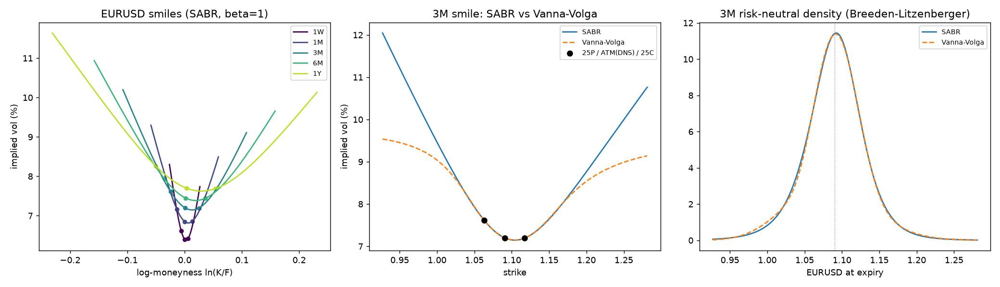
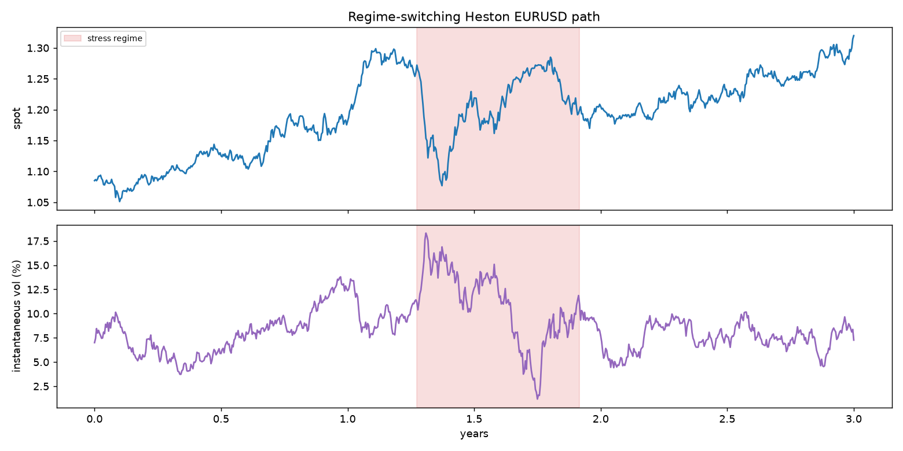

# DeltaSigma

**AI-driven FX options pricing, hedging & market-making research lab.**

[](https://github.com/Nit17/DeltaSigma/actions/workflows/ci.yml)


DeltaSigma is an end-to-end research platform for systematic FX options trading.
It goes from market-convention-correct pricing and volatility-surface construction
through a regime-switching market simulator, deep hedging, ML signal research and
a reinforcement-learning market-maker, with the validation discipline needed to
take a model from research into production.

> **Status:** Phase 1 (pricing, vol surface, market simulator) is complete and tested.
> Later phases are listed in the [roadmap](#roadmap).

---

## Highlights (Phase 1)

| Area | What is implemented | Why it matters on an FX options desk |
|---|---|---|
| **Pricing** | Garman-Kohlhagen price + full Greeks (delta, gamma, vega, **vanna, volga**, theta, both rhos) and a robust implied-vol solver | Vanna and volga are the risks that drive smile pricing and hedging |
| **FX conventions** | Spot / forward / **premium-adjusted** deltas, ATM-forward and **delta-neutral straddle**, per-pair rules (EURUSD vs USDJPY), short vs long tenor switch | Mixing up delta conventions puts every smile pillar at the wrong strike |
| **Smile from quotes** | ATM / 25D RR / 25D BF → smile, with **broker (market) strangle calibration** | Interbank BF quotes are market strangles; treating them as smile strangles mis-prices the wings |
| **Smile models** | **SABR** (Hagan, β = 1) and **Vanna-Volga** (Castagna-Mercurio second order) | The two workhorse FX smile models, side by side |
| **Surface** | Total-variance interpolation in forward moneyness; butterfly (density) and calendar arbitrage checks | Arbitrage-free inputs are required before any ML model sees the surface |
| **Simulator** | Heston with **Andersen QE** scheme + **Markov regime switching** (calm ↔ stress); semi-analytic Heston pricer for validation | Non-stationary, regime-changing synthetic markets for stress-testing ML policies |





### Market strangle vs smile strangle

From `python examples/01_vol_surface.py` (illustrative EURUSD quotes, vols in %):

```
tenor     K25P     KATM     K25C  vol25P    ATM  vol25C  mktBF smileBF  arb-free
   1M   1.0719   1.0868   1.1013   7.162  6.850   6.862  0.160   0.162  True
   3M   1.0633   1.0906   1.1171   7.613  7.200   7.193  0.200   0.203  True
   1Y   1.0501   1.1080   1.1651   8.265  7.700   7.685  0.270   0.275  True
```

The smile strangle that reprices the quoted market strangle is wider than the quoted
BF. The gap grows with skew and tenor, which is what you see in live FX markets.

---

## Validation

There are 91 tests at ~98% line coverage, and they run in CI on Python 3.10, 3.12 and 3.13.

- Put-call parity, zero-vol limits, and **every Greek checked against finite differences**
- Delta to strike round trips for all four delta conventions, calls and puts, 10D and 25D
- DNS strike gives a delta-neutral straddle under each convention
- SABR and Vanna-Volga reproduce the quoted pillars exactly; the broker-strangle premium is matched to 1e-12
- The risk-neutral density integrates to 1 and its mean equals the forward
- Heston Fourier price → Garman-Kohlhagen as vol-of-vol → 0; **QE Monte Carlo agrees with the Fourier price within 4 standard errors**
- Regime occupancy matches the Markov chain's `expm(Q t)`; variance stays non-negative when the Feller condition fails

---

## Quickstart

```bash
git clone https://github.com/Nit17/DeltaSigma.git
cd DeltaSigma
python -m venv .venv && source .venv/bin/activate   # Windows: .venv\Scripts\activate
pip install -e ".[dev]"
pytest
python examples/01_vol_surface.py
python examples/02_regime_simulation.py
```

```python
from deltasigma.pricing import CONVENTIONS, greeks
from deltasigma.vol import FXSmile, SmileQuote
from deltasigma.sim import eurusd_calm_stress_model

# 3M EURUSD smile from market quotes (broker strangle)
smile = FXSmile(spot=1.085, T=0.25, rd=0.043, rf=0.025,
                quote=SmileQuote(atm=0.072, rr25=-0.0042, bf25=0.0020),
                convention=CONVENTIONS["EURUSD"], model="sabr")
k10p = smile.strike_for_delta(-0.10, call=False)   # smile-consistent 10D put strike
print(k10p, smile.vol(k10p), smile.is_butterfly_arbitrage_free())

g = greeks(1.085, k10p, 0.25, 0.043, 0.025, smile.vol(k10p), call=False)
print(g.spot_delta, g.vega, g.vanna, g.volga)

# 1 year of regime-switching market paths
paths = eurusd_calm_stress_model().simulate(S0=1.085, T=1.0, n_steps=252, n_paths=10_000, seed=0)
```

---

## Project layout

```
src/deltasigma/
├── pricing/
│   ├── garman_kohlhagen.py   # prices, Greeks, implied vol
│   └── conventions.py        # delta types, ATM types, pair conventions, delta→strike
├── vol/
│   ├── sabr.py               # Hagan SABR + calibration
│   ├── vanna_volga.py        # Castagna-Mercurio VV smile
│   ├── smile.py              # quotes → smile, broker-strangle solve, density / arbitrage checks
│   ├── surface.py            # term structure, total-variance interpolation, calendar checks
│   └── sample_market.py      # illustrative EURUSD snapshot
└── sim/
    ├── heston.py             # Fourier pricer, QE variance + log-spot steps
    └── regime.py             # Markov regime-switching Heston simulator
tests/                        # pytest suite
examples/                     # runnable scripts that produce the figures above
```

---

## Roadmap

- [x] **Phase 1: Pricing and volatility foundations.** FX conventions, SABR / Vanna-Volga smiles, broker-strangle calibration, arbitrage checks, regime-switching Heston simulator.
- [ ] **Phase 2: Deep hedging.** A PyTorch hedging policy for an FX options book with transaction costs and risk-measure objectives (CVaR), benchmarked against BS delta and delta-vega hedging across calm and stress regimes.
- [ ] **Phase 3: Vol signal research.** Forecasting the vol surface and the realised-vs-implied vol premium (HAR-RV, gradient boosting, sequence models) with walk-forward evaluation, purged / embargoed CV, leakage checks and regime detection.
- [ ] **Phase 4: RL market-making.** An FX options RFQ simulator with client flow and a win-probability model; a PPO quoting agent with Greek inventory limits, compared against an Avellaneda-Stoikov-style baseline.
- [ ] **Phase 5: Production.** Greek-based PnL attribution, model drift monitoring, a backtest report and a pricing / quoting service.

## Data

FX implied-vol data is not freely available, so the research core runs on a
**calibrated synthetic market** (the regime-switching simulator), and later phases
add free historical FX spot data where it is needed. The sample EURUSD quotes are
illustrative and are not live market data.

## References

- Clark, I. (2011). *Foreign Exchange Option Pricing: A Practitioner's Guide.* Wiley.
- Reiswich, D. & Wystup, U. (2010). *A Guide to FX Options Quoting Conventions.*
- Hagan, P. et al. (2002). *Managing Smile Risk.* Wilmott.
- Castagna, A. & Mercurio, F. (2007). *The Vanna-Volga Method for Implied Volatilities.* Risk.
- Andersen, L. (2008). *Simple and Efficient Simulation of the Heston Stochastic Volatility Model.*
- Albrecher, H. et al. (2007). *The Little Heston Trap.*
- Buehler, H. et al. (2019). *Deep Hedging.* Quantitative Finance.

## Author

**Nithin B M** · [GitHub @Nit17](https://github.com/Nit17) · nithinbm17@gmail.com
