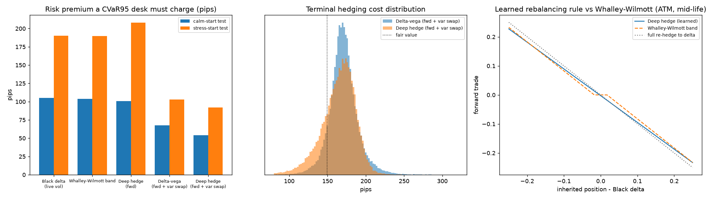
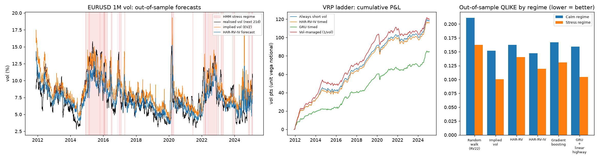

# DeltaSigma

**AI-driven FX options pricing, hedging & market-making research lab.**

[](https://github.com/Nit17/DeltaSigma/actions/workflows/ci.yml)


DeltaSigma is an end-to-end research platform for systematic FX options trading.
It goes from market-convention-correct pricing and volatility-surface construction
through a regime-switching market simulator, deep hedging, ML signal research and
a reinforcement-learning market-maker, with the validation discipline needed to
take a model from research into production.

> **Status:** Phases 1–3 (pricing and vol surface, deep hedging, vol signal research on
> real EURUSD data) are complete and tested. Later phases are listed in the [roadmap](#roadmap).

---

## Highlights (Phase 1)

| Area | What is implemented | Why it matters on an FX options desk |
|---|---|---|
| **Pricing** | Garman-Kohlhagen price + full Greeks (delta, gamma, vega, **vanna, volga**, theta, both rhos) and a robust implied-vol solver | Vanna and volga are the risks that drive smile pricing and hedging |
| **FX conventions** | Spot / forward / **premium-adjusted** deltas, ATM-forward and **delta-neutral straddle**, per-pair rules (EURUSD vs USDJPY), short vs long tenor switch | Mixing up delta conventions puts every smile pillar at the wrong strike |
| **Smile from quotes** | ATM / 25D RR / 25D BF → smile, with **broker (market) strangle calibration** | Interbank BF quotes are market strangles; treating them as smile strangles mis-prices the wings |
| **Smile models** | **SABR** (Hagan, β = 1) and **Vanna-Volga** (Castagna-Mercurio second order) | The two workhorse FX smile models, side by side |
| **Surface** | Total-variance interpolation in forward moneyness; butterfly (density) and calendar arbitrage checks | Arbitrage-free inputs are required before any ML model sees the surface |
| **Simulator** | Heston with **Andersen QE** scheme + **Markov regime switching** (calm ↔ stress); semi-analytic Heston pricer for validation | Non-stationary, regime-changing synthetic markets for stress-testing ML policies |


### Market strangle vs smile strangle

From `python examples/01_vol_surface.py` (illustrative EURUSD quotes, vols in %):

```
tenor     K25P     KATM     K25C  vol25P    ATM  vol25C  mktBF smileBF  arb-free
   1M   1.0719   1.0868   1.1013   7.162  6.850   6.862  0.160   0.162  True
   3M   1.0633   1.0906   1.1171   7.613  7.200   7.193  0.200   0.203  True
   1Y   1.0501   1.1080   1.1651   8.265  7.700   7.685  0.270   0.275  True
```

The smile strangle that reprices the quoted market strangle is wider than the quoted
BF. The gap grows with skew and tenor, which is what you see in live FX markets.

---

## Phase 2: Deep hedging an FX options book

A PyTorch policy learns to hedge a **short 3M EURUSD ATM call** with daily rebalancing and
transaction costs, trained end to end through the simulated P&L to minimise **CVaR95**
(Buehler et al., 2019; Rockafellar-Uryasev objective). It trades two instruments:
- **FX forwards** (2 bp cost)
- a **variance swap** (0.2 vol pt half-spread)

The variance swap is priced **exactly** under the regime-switching simulator using a
linear moment recursion. Its price is therefore a true martingale, so the network
cannot "learn" fake arbitrage from pricing error.

**Design choices that matter in practice:**
- **Residual policy:** the network outputs a correction to the Black delta (-vega)
  hedge. Before training it reproduces the textbook hedge exactly, so it learns only
  where deviating pays.
- **Clean evaluation:**
  - Benchmarks are tuned on training data only; Whalley-Wilmott's risk aversion is
    picked by grid search on CVaR.
  - Feature normalisation is fitted on training data only.
  - Early stopping uses a separate validation market.
  - All numbers below are from **unseen test paths**.
- **Regime stress test:** the models are trained on paths that start in the calm regime,
  then evaluated on a market that **starts in the stress regime**, which they never saw.



Selected out-of-sample results (pips per EUR notional; full tables in
[docs/deep_hedging_results.md](docs/deep_hedging_results.md)):

| Strategy | CVaR95 (calm start) | CVaR99 (calm start) | Txn costs | CVaR95 (stress start) | CVaR99 (stress start) |
|---|---:|---:|---:|---:|---:|
| Black delta (live vol) | 254.5 | 298.4 | 6.4 | 477.5 | 547.6 |
| Whalley-Wilmott band (tuned) | 253.2 | 297.1 | 4.9 | 476.9 | 546.4 |
| **Deep hedge (fwd)** | **249.9** | **291.1** | 5.1 | 495.3 | 600.4 |
| Delta-vega (fwd + var swap) | 217.1 | 241.9 | 21.0 | 390.2 | 433.0 |
| **Deep hedge (fwd + var swap)** | **203.5** | **216.9** | **14.3** | **379.2** | **402.4** |

**What the results show:**
- **With a vol instrument, the deep hedger beats every benchmark.** Compared with
  delta-vega, CVaR99 is **10% lower** and transaction costs are **32% lower**.
  - The premium a CVaR95-constrained desk must charge above fair value falls from
    67.8 to **54.1 pips (-20%)**. That is the same as quoting a tighter price for the
    same tail risk.
  - The advantage holds in the unseen stress regime (CVaR99 402 vs 433).
- **With forwards only, the gains are small.** Most of the remaining risk is vol risk,
  which forwards cannot hedge, so the network mainly saves costs. It learned
  *partial adjustment*: it trades about 91% of each deviation from delta, cutting
  turnover from 2.96 to 2.35 (right panel).
- **The forwards-only network does *not* generalise to the stress regime.** It is worse
  than plain delta hedging there (CVaR99 600 vs 548), because it was trained almost only
  on calm-regime states. This is exactly the regime-shift failure that production
  monitoring has to catch. It motivates the drift detection and regime-randomised
  training planned in Phases 3 and 5.

Reproduce with `python examples/03_deep_hedging.py` (~8 min on a laptop CPU, fixed seeds).

---

## Phase 3: Vol signal research on real EURUSD data

Phase 3 forecasts EURUSD 1-month realised volatility and tests whether the forecasts
improve a **variance-risk-premium (VRP)** strategy that sells 1M vol. It uses real data
from Nov 2007 to Mar 2025:
- EURUSD spot from FRED (DEXUSEU)
- the CBOE EuroCurrency volatility index (EVZ)

The out-of-sample period is **Nov 2011 to Feb 2025**: 3,286 days, covering the
euro-crisis aftermath, COVID and the 2022 rates shock.

**Research hygiene.** Overfitting and leakage are the usual way results like these go
wrong, so each one has a dedicated safeguard:

| Risk | Control |
|---|---|
| Look-ahead in features | An automated **prefix audit**: every feature is recomputed on truncated history and must match. It catches centred windows and full-sample scaling (both tested). **0 violations.** |
| Overlapping 21-day labels | **Purged** expanding walk-forward (López de Prado). Training labels never reach into the test block. Refit every 6 months, 27 folds. |
| Hyper-parameter snooping | Gradient boosting is tuned by **nested purged K-fold with an embargo**, inside each training window only. |
| Regime look-ahead | The HMM regime probability is **filtered, not smoothed**, and refit on an expanding window at fixed dates (audited). |
| "Better" by chance | Diebold-Mariano tests on QLIKE with a HAC variance for overlapping forecasts and the HLN small-sample correction. |
| Backtest cherry-picking | The trading threshold is fixed ex ante (2x the half-spread), Sharpe is averaged over all 21 roll offsets, and **all six strategy variants tried are reported**. |



Forecast accuracy, out of sample (full tables in
[docs/vol_research_results.md](docs/vol_research_results.md)):

| Model | QLIKE (all) | R² vs HAR-RV | QLIKE (stress regime) | DM p-value vs HAR (stress) |
|---|---:|---:|---:|---:|
| Random walk (trailing 1M RV) | 0.201 | -11% | 0.162 | worse |
| HAR-RV (Corsi 2009) | 0.158 | — | 0.141 | — |
| Implied vol (EVZ) | 0.142 | -8% | 0.101 | **0.002** |
| **HAR-RV-IV** | **0.142** | **+20%** | 0.119 | 0.21 |
| Gradient boosting (nested CV) | 0.160 | +3% | 0.131 | 0.67 |
| GRU + linear highway | 0.148 | +8% | **0.105** | **0.020** |

**What the results show:**
- **Implied vol is the strongest single predictor.** Adding it to HAR gives the best
  overall model (+20% out-of-sample R², DM p = 0.06).
  - The market's own forecast is hard to beat with price history alone.
- **Non-linear ML adds little on ~3,000 noisy, overlapping daily labels.**
  - Gradient boosting does no better than linear HAR.
  - The GRU is competitive overall and is the only learned model that is
    **significantly better than HAR in the stress regime** (p = 0.02).
  - That fits Phase 2: model value is concentrated in the regimes where simple models
    break down.
- **Better forecasts are not a better strategy.** Selling vol every day earns about
  +0.74 vol pts per trade (Sharpe 1.34 after 0.25 vol pt costs). Every
  forecast-based variant has a Sharpe of 1.16–1.34, so none improves on it:

| VRP strategy (21-day vol swaps) | Active % | Sharpe | Max drawdown (vol pts) | Avg worst 5% trades |
|---|---:|---:|---:|---:|
| Always short vol | 100 | **1.34** | 9.3 | -3.69 |
| HAR-RV-IV timed | 98 | 1.34 | 9.3 | -3.68 |
| GRU timed | 64 | 1.16 | **7.2** | **-3.52** |
| Gradient boosting timed | 68 | 1.19 | 8.9 | -3.53 |
| Vol-managed (1/vol) | 100 | 1.27 | 12.2 | -4.27 |
| VRP/vol sized | 100 | 1.19 | 11.0 | -4.04 |

  - The predicted premium is positive almost every day, so timing has little to act on.
  - The forecasts do help with **risk**: GRU timing cuts the maximum drawdown by 23% and
    trades a third less, while keeping 87% of the Sharpe.
  - Vol-managed sizing, which helps in equities, makes EURUSD short-vol *worse*: it adds
    risk in quiet markets right before vol spikes.

The VRP backtest treats the 30-day EVZ index as a tradable vol-swap strike with a fixed
half-spread and no convexity adjustment, so read it as a signal study, not a P&L
estimate.

Reproduce with `python examples/04_vol_research.py` (~4 min; downloads and caches the
FRED data). `--synthetic --quick` runs the same pipeline offline on simulated data.

---

## Validation

There are 131 tests at ~96% line coverage, and they run in CI on Python 3.10, 3.12 and 3.13.

- Put-call parity, zero-vol limits, and **every Greek checked against finite differences**
- Delta to strike round trips for all four delta conventions, calls and puts, 10D and 25D
- DNS strike gives a delta-neutral straddle under each convention
- SABR and Vanna-Volga reproduce the quoted pillars exactly; the broker-strangle premium is matched to 1e-12
- The risk-neutral density integrates to 1 and its mean equals the forward
- Heston Fourier price → Garman-Kohlhagen as vol-of-vol → 0; **QE Monte Carlo agrees with the Fourier price within 4 standard errors**
- Regime occupancy matches the Markov chain's `expm(Q t)`; variance stays non-negative when the Feller condition fails
- The forward and variance-swap prices are martingales; the variance swap settles exactly on realised variance
- The cost-free delta hedge replicates the Black-Scholes price, and hedging error shrinks like `1/sqrt(n)` with more frequent rebalancing
- The untrained residual policy equals Black delta; the **PyTorch loss matches the NumPy P&L engine**; training is deterministic and beats delta hedging out of sample
- The leakage audit flags deliberately leaky features (centred windows, full-sample z-scores) and passes the real pipeline
- Purged walk-forward and K-fold never let a training label overlap the test labels, and the embargo is enforced
- The HMM recovers the regime vols, its filter is prefix-invariant, and it tracks the latent vol level on simulated data
- On synthetic data where implied vol is the true expected vol, HAR-RV-IV beats HAR-RV with a significant DM statistic; QLIKE is minimised at the truth

---

## Quickstart

```bash
git clone https://github.com/Nit17/DeltaSigma.git
cd DeltaSigma
python -m venv .venv && source .venv/bin/activate   # Windows: .venv\Scripts\activate
pip install -e ".[dev]"          # includes pandas + scikit-learn for research
pip install torch --index-url https://download.pytorch.org/whl/cpu   # deep hedging, GRU
pytest
python examples/01_vol_surface.py
python examples/02_regime_simulation.py
python examples/03_deep_hedging.py
python examples/04_vol_research.py
```

```python
from deltasigma.pricing import CONVENTIONS, greeks
from deltasigma.vol import FXSmile, SmileQuote
from deltasigma.sim import eurusd_calm_stress_model

# 3M EURUSD smile from market quotes (broker strangle)
smile = FXSmile(spot=1.085, T=0.25, rd=0.043, rf=0.025,
                quote=SmileQuote(atm=0.072, rr25=-0.0042, bf25=0.0020),
                convention=CONVENTIONS["EURUSD"], model="sabr")
k10p = smile.strike_for_delta(-0.10, call=False)   # smile-consistent 10D put strike
print(k10p, smile.vol(k10p), smile.is_butterfly_arbitrage_free())

g = greeks(1.085, k10p, 0.25, 0.043, 0.025, smile.vol(k10p), call=False)
print(g.spot_delta, g.vega, g.vanna, g.volga)

# 1 year of regime-switching market paths
paths = eurusd_calm_stress_model().simulate(S0=1.085, T=1.0, n_steps=252, n_paths=10_000, seed=0)
```

---

## Project layout

```
src/deltasigma/
├── pricing/
│   ├── garman_kohlhagen.py   # prices, Greeks, implied vol
│   └── conventions.py        # delta types, ATM types, pair conventions, delta→strike
├── vol/
│   ├── sabr.py               # Hagan SABR + calibration
│   ├── vanna_volga.py        # Castagna-Mercurio VV smile
│   ├── smile.py              # quotes → smile, broker-strangle solve, density / arbitrage checks
│   ├── surface.py            # term structure, total-variance interpolation, calendar checks
│   └── sample_market.py      # illustrative EURUSD snapshot
├── sim/
│   ├── heston.py             # Fourier pricer, QE variance + log-spot steps
│   └── regime.py             # Markov regime-switching Heston simulator
├── hedging/
│   ├── market.py             # hedge instruments, exact regime-aware variance swap
│   ├── pnl.py                # transaction costs, terminal P&L, CVaR metrics
│   ├── strategies.py         # Black delta, delta-vega, Whalley-Wilmott benchmarks
│   └── deep.py               # PyTorch deep hedger (residual policy, CVaR training)
└── research/
    ├── data.py               # FRED loader (cached) + synthetic twin with known truth
    ├── features.py           # causal HAR / implied-vol features, forward RV target
    ├── leakage.py            # automated look-ahead audit
    ├── cv.py                 # purged walk-forward, purged K-fold with embargo
    ├── regime.py             # Gaussian HMM, causal filtered regime probability
    ├── models.py             # HAR-RV(-IV), gradient boosting (nested CV), GRU
    ├── evaluation.py         # walk-forward driver, QLIKE, Diebold-Mariano
    └── backtest.py           # VRP vol-swap backtest, offset-averaged statistics
tests/                        # pytest suite
examples/                     # runnable scripts that produce the figures above
```

---

## Roadmap

- [x] **Phase 1: Pricing and volatility foundations.** FX conventions, SABR / Vanna-Volga smiles, broker-strangle calibration, arbitrage checks, regime-switching Heston simulator.
- [x] **Phase 2: Deep hedging.** A PyTorch CVaR hedging policy with transaction costs, benchmarked against Black delta, Whalley-Wilmott and delta-vega hedging in calm and stress regimes.
- [x] **Phase 3: Vol signal research.** Real EURUSD realised-vol forecasting (HAR-RV, HAR-RV-IV, gradient boosting, GRU) with leakage audits, purged walk-forward and nested CV, HMM regime detection, Diebold-Mariano tests and a VRP backtest.
- [ ] **Phase 4: RL market-making.** An FX options RFQ simulator with client flow and a win-probability model; a PPO quoting agent with Greek inventory limits, compared against an Avellaneda-Stoikov-style baseline.
- [ ] **Phase 5: Production.** Greek-based PnL attribution, model drift monitoring (catching failures like the forwards-only hedger's stress-regime breakdown), regime-randomised retraining, a backtest report and a pricing / quoting service.

## Data

- **Phases 1–2:** a calibrated synthetic market (the regime-switching simulator). The
  sample EURUSD smile quotes are illustrative, not live market data.
- **Phase 3: real public data.**
  - EURUSD spot: Federal Reserve H.10 via FRED `DEXUSEU`.
  - 30-day implied vol: CBOE EuroCurrency ETF Volatility Index via FRED `EVZCLS`,
    discontinued in 2025.
  - The files are downloaded on first run and cached in `data/raw/`. That folder is
    git-ignored, so the data is not redistributed.
  - Tests and CI use a synthetic twin with known ground truth.

## References

- Clark, I. (2011). *Foreign Exchange Option Pricing: A Practitioner's Guide.* Wiley.
- Reiswich, D. & Wystup, U. (2010). *A Guide to FX Options Quoting Conventions.*
- Hagan, P. et al. (2002). *Managing Smile Risk.* Wilmott.
- Castagna, A. & Mercurio, F. (2007). *The Vanna-Volga Method for Implied Volatilities.* Risk.
- Andersen, L. (2008). *Simple and Efficient Simulation of the Heston Stochastic Volatility Model.*
- Albrecher, H. et al. (2007). *The Little Heston Trap.*
- Buehler, H. et al. (2019). *Deep Hedging.* Quantitative Finance.
- Whalley, A. E. & Wilmott, P. (1997). *An Asymptotic Analysis of an Optimal Hedging Model for Option Pricing with Transaction Costs.* Mathematical Finance.
- Rockafellar, R. T. & Uryasev, S. (2000). *Optimization of Conditional Value-at-Risk.* Journal of Risk.
- Corsi, F. (2009). *A Simple Approximate Long-Memory Model of Realized Volatility.* Journal of Financial Econometrics.
- Patton, A. (2011). *Volatility Forecast Comparison Using Imperfect Volatility Proxies.* Journal of Econometrics.
- Diebold, F. & Mariano, R. (1995). *Comparing Predictive Accuracy.*; Harvey, D., Leybourne, S. & Newbold, P. (1997).
- López de Prado, M. (2018). *Advances in Financial Machine Learning.* Wiley (purging, embargo).
- Hamilton, J. (1989). *A New Approach to the Economic Analysis of Nonstationary Time Series and the Business Cycle.* Econometrica.
- Lai, G. et al. (2018). *Modeling Long- and Short-Term Temporal Patterns with Deep Neural Networks (LSTNet).* SIGIR.
- Moreira, A. & Muir, T. (2017). *Volatility-Managed Portfolios.* Journal of Finance.

## Author

**Nithin B M** · [GitHub @Nit17](https://github.com/Nit17) · nithinbm17@gmail.com
